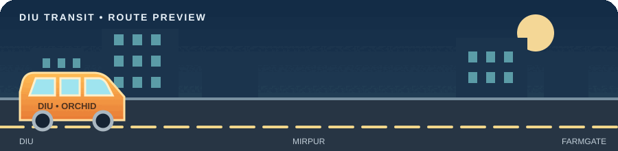

# DIU Bus Seat Booking System

This project is a menu-driven bus seat booking program written in C. It models DIU ORCHID bus trips between DIU and Farmgate and lets passengers reserve seats, pay their fare on the bus, or cancel an existing ticket.

## Features

- Book one or several seats on a selected date, route, and bus.
- View a 40-seat layout and avoid seats already booked for overlapping route segments.
- Apply reserved seating for female students and faculty.
- Calculate fares from the route's configured distance estimates.
- Charge an advance booking fee for future-date reservations; same-day bookings have no advance fee.
- Pay the travel fare on the bus, with no advance booking fee.
- Cancel all active seats associated with a ticket number.
- Save booking records between runs in orchid_bookings.txt.
- Validate menu choices, passenger names, and travel dates; past dates are rejected.

## Requirements

- A C compiler such as GCC or Clang.
- A terminal or command prompt.

## Build and run

From this folder, compile with GCC:

~~~bash
gcc -std=c99 -Wall -Wextra -pedantic bus_booking_system.c -o bus_booking_system
~~~

Run on Linux or macOS:

~~~bash
./bus_booking_system
~~~

Run on Windows Command Prompt:

~~~bat
bus_booking_system.exe
~~~

The program creates or updates orchid_bookings.txt in its current working directory. Keep this file if you want to retain booking records between runs. Remove it only if you want to reset the local demo data.

## How to use

1. Start the program and choose an option from the main menu.
2. For a reservation, enter passenger category and name, travel date, direction, boarding and destination stations, and bus.
3. Choose the number of seats and enter each seat number shown as available.
4. Review the fare and confirm. The program prints a ticket number and receipt.
5. Choose Pay Fare On Bus to record a same-day ride without an advance fee, or Cancel Ticket and enter the ticket number to cancel its active seats.

## Bus animation

The animated bus above appears directly on the GitHub repository overview. For a larger, interactive route scene, open bus-animation.html in a modern web browser. It uses only HTML and CSS and needs no additional packages.

## Project structure

~~~text
DIU-Bus-Seat-Booking-System/
├── README.md
├── bus_booking_system.c
├── bus-animation.html
├── portfolio-banner.svg
├── bus-route-animation.gif
└── .gitignore
~~~

orchid_bookings.txt is generated when the program saves its first confirmed booking and is intentionally excluded from version control.

## Notes and limitations

- This is a console-based educational project. It does not use a database, web server, payment gateway, or live bus tracking.
- Station travel times and distances are configured inside the source. The distance values are approximate project estimates, not verified road distances; fares depend on those configured estimates.
- Booking data is stored as a plain text file on the computer running the program. It is not shared across machines.
- The route, trip schedule, fares, and reserved-seat policy are demonstration rules defined in the code and should be checked before real-world use.

## License

No license has been selected. Add a license file before others reuse or redistribute the project.
